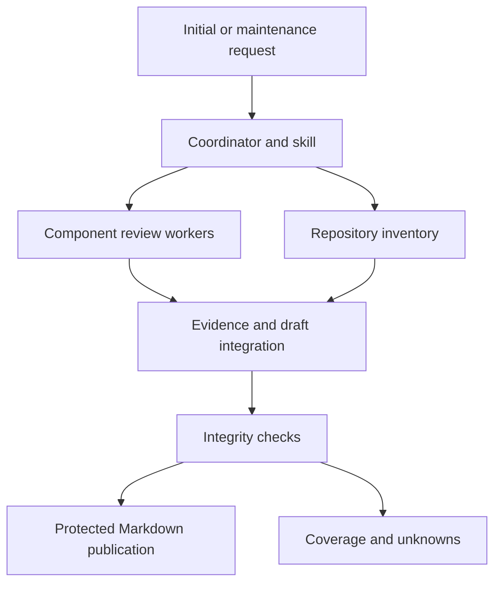

# Architecture and recommendations

## Contents

- [Why a plugin](#why-a-plugin)
- [Responsibilities](#responsibilities)
- [Evidence and uncertainty](#evidence-and-uncertainty)
- [Coverage](#coverage)
- [Parallel workers](#parallel-workers)
- [Maintenance and preservation](#maintenance-and-preservation)
- [Practical limits](#practical-limits)
- [Upstream references](#upstream-references)

## Why a plugin

Use an OMP extension package containing a skill, a local engine and documentation templates. This gives users a repeatable command while keeping the investigation rules small enough to load on demand. A standalone prompt cannot itself enforce file boundaries, check hashes or reliably preserve content. The engine supplies those mechanical controls; the skill supplies judgment.

Do not add a separate hosted service, database, embedding index or MCP server for the initial version. Repository-local JSON is inspectable, portable and sufficient for the first implementation. These additional systems should earn their cost against measured repository sizes and actual bottlenecks.

## Responsibilities

| Layer | Owns | Does not establish |
| --- | --- | --- |
| OMP extension | Command routing, tool registration, root boundary and workflow startup | Semantic correctness of documentation |
| Agent skill | Repository understanding, investigation, plain-English writing, cross-component synthesis and editorial review | Deterministic file safety by instruction alone |
| Integrity engine | Inventory, hashes, claim records, coverage, safe publishing and selected link checks | Whether cited code logically supports a claim |
| Repository records | Evidence, changes, exclusions, unknowns and ownership history | An immutable audit trail against a malicious writer |
| Human-authored documentation | Context, explanations, design history and operational knowledge | Current behavior unless reverified against evidence |

## Evidence and uncertainty

The central rule is: **describe observed implementation and established contracts; label what remains uncertain.**

For example, a configuration sample saying `PORT=8080` does not prove that 8080 is the runtime default. Read the parser, environment precedence, startup path and relevant tests. If the default depends on an external launcher that is missing, say so and describe how to obtain the missing launcher or observe startup in an appropriate environment.

Use four claim states:

| State | Reader-facing treatment |
| --- | --- |
| `supported` | State the fact, identify the scope and link the evidence. |
| `inference` | Explain the evidence and reasoning, label the conclusion as an inference, and give a way to confirm it. |
| `unknown` | State the unanswered question, its impact and next investigation steps. |
| `conflict` | Describe the incompatible evidence and the practical consequence; avoid selecting a convenient answer. |

A source citation records a path, file hash and line range. The hash detects changes; it does not prove that the lines mean what the writer says. The coordinator must read the cited implementation and inspect surrounding control flow before accepting worker findings. Use multiple sources for claims spanning configuration, callers, storage and error handling.

Keep declared behavior, implementation behavior and observed execution results distinct. A test file is evidence of a test definition. A successful run is evidence of that run, on that revision, with those inputs and environment. Neither establishes behavior outside its scope.

An investigation should make progress. After three targeted attempts that add no decisive evidence, record the unknown and continue independent documentation work. Revisit it only when new evidence or a materially different investigation route becomes available.

## Coverage

Publish several measurements rather than one universal percentage:

| Measurement | Meaning |
| --- | --- |
| Inventoried scope | Files and repository boundaries enumerated, with omitted or unavailable inputs disclosed. |
| Reviewed files | Current files with an explicit recorded review. |
| Documented files | Reviewed files linked to existing documentation and a current supported claim. |
| Documentation-page review | Existing output pages, including manual pages, explicitly checked for clarity and evidence. |
| Claim freshness | Claim evidence and linked document bytes still match the records. |
| Declared symbols | Functions, classes and methods the agent explicitly enumerated. This is not an exhaustive parser-derived denominator. |
| Open unknowns and conflicts | Remaining facts that cannot yet be established or reconciled. |

Complete file coverage does not imply complete behavioral coverage. A file with twenty public methods can be linked to a page that describes only one. The skill must build a symbol checklist and verify each required entry; the initial engine does not pretend a generic regex can discover every language construct.

## Parallel workers

The default policy is automatic delegation with a maximum of three simultaneous review workers. The coordinator is additional to this limit. The OMP host may impose a smaller available-worker limit; respect it.

The coordinator first identifies entry points, shared configuration and module boundaries. It then partitions work by independent components or responsibilities. Avoid giving every worker the whole repository. Each brief includes the source snapshot, relevant paths, neighboring interfaces, intended reader, evidence format and owned draft output.

Workers can inspect source and return drafts, claims, symbol records and questions. They do not publish final pages, renew the main coverage ledger or spawn additional workers. Drafts use distinct paths under `.documenter/work/` if file output is needed. Keep records small; reference large source files instead of copying them into every prompt.

The coordinator waits for actual completion, checks returned hashes, reads the cited source, reconciles contradictory conclusions, traces interfaces between components and performs one consistent editorial pass. It writes state and final pages serially. A repository change during analysis makes affected results stale; the conservative initial engine invalidates all prior source-snapshot reviews rather than guessing that an unmodeled dependency is irrelevant.

There is no fixed task-tool JSON in the skill because OMP's available task schema can vary with configuration. Inspect the actual tool schema before delegation. Use current host model routing unless the user or project defines something else. Start with the current model, then use stronger reasoning selectively for ambiguous control flow, concurrency, authentication or recovery. Parallelism reduces elapsed time when tasks are independent; duplicated context and unnecessary workers can increase token cost.

## Maintenance and preservation

The source of truth is the current working tree, including relevant uncommitted changes. A commit identifier alone is insufficient. Each maintenance run compares file content and scope with the prior inventory, then checks old claims and links.

Version 1 uses whole-page ownership:

1. New generated Markdown pages can be created inside the configured documentation root.
2. A generated page can be replaced only when both the caller's expected hash and Documenter's ownership hash match its current content.
3. A pre-existing page is human-owned. A generated page becomes protected when its bytes differ from the ownership record.
4. Protected text remains unchanged. Proposed content is saved separately, and the conflict is reported.
5. A journal records updates and stores the previous page before replacement.

This design deliberately avoids an automatic three-way merge for mixed prose. A future section-level merge should preserve a true generation baseline, show conflicts and have its own tests before it becomes the default. Do not offer an override flag that silently claims ownership of manually written text.

The coordinator can still complete useful work without stopping for every conflict: write a companion clarification, record an unknown or proposal, and update independent pages. Report a completed run with explicit gaps when verification or content ownership prevents full completion.

## Practical limits

- The agent, language tools and tests provide semantic analysis. The engine does not parse every programming language or infer a complete call graph.
- Available nested repositories and checked-out submodules are inventoried; unavailable submodules are gaps, and no fetch or checkout occurs automatically.
- Filename-based secret exclusions are precautionary. They are not a comprehensive secret scanner. Never quote real credentials discovered elsewhere.
- The engine is not an operating-system sandbox. Another process with write access can alter files or state. A lock coordinates cooperating Documenter writers; it does not lock editors or malicious processes.
- Atomic page replacement and a journal help recovery, but page bytes and JSON state are not one database transaction.
- Local Markdown link validation covers a stated subset. Remote links, site-specific routes and complex syntax require separate review or an installed documentation renderer.
- No repository scripts, package installation, services or tests are executed by the engine. Any runtime verification uses the host's existing authorization and isolation policies.

## Upstream references

Integration interfaces were checked on 16 November 2026. These are upstream `main` URLs and may evolve:

- [Extension authoring](https://github.com/can1357/oh-my-pi/blob/main/docs/skills/authoring-extensions.md): extension factory, commands, tools and manifest.
- [Plugin manager](https://github.com/can1357/oh-my-pi/blob/main/docs/plugin-manager-installer-plumbing.md): local links and package discovery.
- [Skills](https://github.com/can1357/oh-my-pi/blob/main/docs/skills.md): skill layout and discovery.
- [Extension API](https://github.com/can1357/oh-my-pi/blob/main/docs/extensions.md): tool execution and message scheduling.
- [Task tool](https://github.com/can1357/oh-my-pi/blob/main/docs/tools/task.md): host-specific worker schemas.
- [Task agent discovery](https://github.com/can1357/oh-my-pi/blob/main/docs/task-agent-discovery.md): worker availability and discovery.
