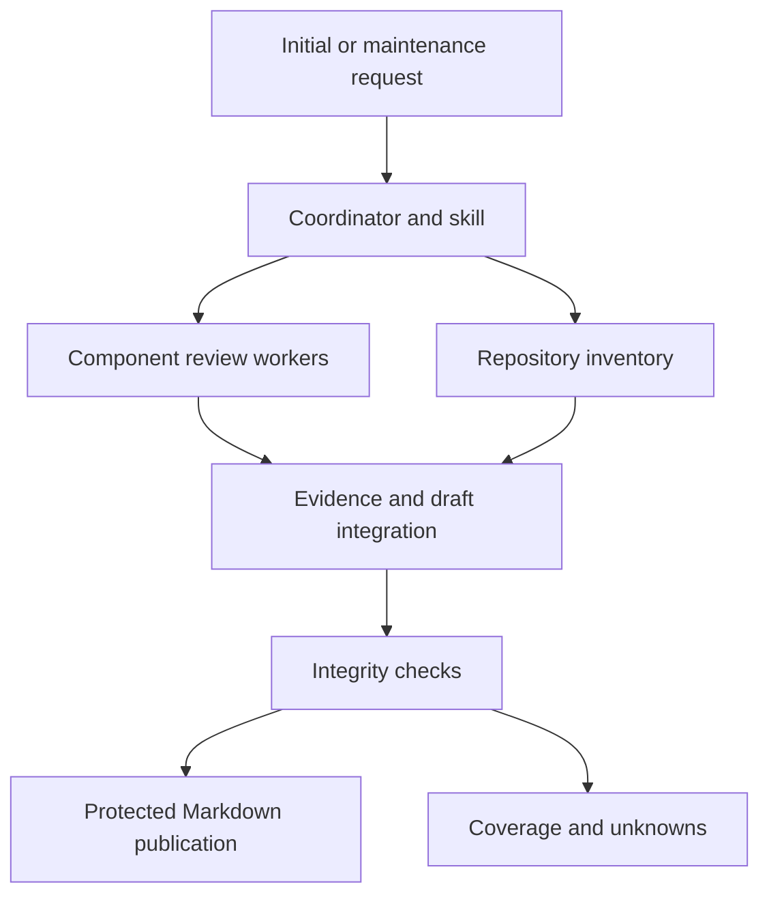

# Combined documentation guide

> Generated from canonical documentation sources. Edit the sources, then regenerate this file.

## Canonical source order

1. README.md
2. docs/USER-GUIDE.md
3. docs/ARCHITECTURE.md
4. docs/ENGINE.md
5. docs/VALIDATION.md
6. docs/ROADMAP.md

## Canonical source: README.md

# OMP Documenter

**Create and maintain repository documentation that describes the code you actually have.**

OMP Documenter is an Oh My Pi extension package with an agent skill and a deterministic integrity engine. The agent investigates the repository and writes the explanation. The engine inventories files, checks evidence locations and hashes, tracks coverage, and protects existing documentation when pages are published.

Documentation must be clear, consistent and user friendly. Every factual explanation must have sufficient evidence. Unknown facts remain visible, with their impact and a practical way to resolve them.

## Start here

1. Install or unpack this package into a permanent directory outside the repository you want to document. Run `npm install --omit=dev` in that directory to install the pinned native Xberg backend. If the backend is unavailable, Markdown and plain-text workflows still work.
2. Link it to OMP:

   ```bash
   omp plugin link /absolute/path/to/omp-documenter
   ```

3. Start a new OMP session in the root of the repository you want to document:

   ```bash
   cd /path/to/your/project
   omp
   ```

4. Run the initial documentation workflow:

   ```text
   /documenter initial
   ```

5. After code changes, run the maintenance workflow:

   ```text
   /documenter maintain
   ```

The directory passed to `plugin link` must remain available. For a single session, load the package directory with `omp --extension /absolute/path/to/omp-documenter` instead.

## What is included

| Part | Purpose |
| --- | --- |
| OMP command `/documenter` | Start initial documentation or maintenance; show status; run mechanical checks. |
| OMP tool `documenter_state` | Give the agent a consistent interface for inventory, records, coverage and safe publication. |
| Skill `omp-documenter` | Define evidence standards, investigation, parallel review, documentation structure and editorial quality. |
| Standalone CLI | Run the same integrity engine without a model or OMP session. |
| Repository state | Keep hashes, coverage, findings, unknowns, page ownership and update journals in `.documenter/`. |
| Tests | Exercise preservation, evidence validation, freshness, repository boundaries and command integration. |

## Everyday commands

| Command in OMP | Result |
| --- | --- |
| `/documenter initial` | Inventory the repository, investigate components, fill missing documentation and report remaining gaps. |
| `/documenter maintain` | Compare the current repository with previous evidence, update safe-to-replace pages, preserve edited content and flag uncertainty. |
| `/documenter status` | Recheck live files and show current coverage and attention items without changing state. |
| `/documenter check` | Check mechanical integrity, stale records, page changes and supported local links. |
| `/documenter check --strict` | Also require the defined scope to have current review and documentation coverage with no unresolved gaps. |

Parallel component reviews default to **automatic, with up to three workers plus the coordinator**, where OMP exposes worker tools. The coordinator owns the final documentation and state. If workers are unavailable, the same workflow runs sequentially.

## Read next

- [User guide](USER-GUIDE.md): installation, initial runs, maintenance, configuration and recovery.
- [Architecture and recommendations](ARCHITECTURE.md): responsibilities, evidence model, parallel work and tradeoffs.
- [Engine reference](ENGINE.md): exact CLI and JSON contracts.
- [Validation and limits](VALIDATION.md): what has been checked and what needs a real OMP host.
- [Roadmap](ROADMAP.md): useful next improvements, in priority order.
- [Agent skill](../skills/omp-documenter/SKILL.md): the instructions OMP follows.

## Compatibility and v2 lifecycle

Documenter 2.0.0 requires Node.js 22 or later. The current qualification run passes 88 tests on Node.js 24.22.3 and Bun 1.4.5, including real Xberg PDF/DOCX extraction, authenticated acquisition and local Tesseract OCR.

The v2 engine retains `scan`, `status`, `record`, `publish`, and `check`. It adds guarded `preview`, `plan`, `overhaul`, `archive`, `stage`, `validate`, `promote`, `resume`, `archives`, `restore`, `page`, `style`, `doctor`, `details`, and `ocr` actions. Use the repository-relative lifecycle documented in [the user guide](USER-GUIDE.md) and [the documentation-set reference](DOCUMENTATION-SET.md).

External output, semantic search, automatic section merging and proprietary providers remain unsupported core capabilities. PDF and DOCX style sources are qualified through pinned `@xberg-io/xberg` 1.5.4. Generic authenticated acquisition is origin-scoped and rejects login pages, redirects and rejected credentials. `tessdata_best`, visual layout fidelity and named-provider login remain unqualified.
Local OCR uses the installed Xberg Tesseract backend. `ocr status`, `ocr doctor`, `ocr models list`, `ocr models verify` and `ocr test` expose readiness and receipts. Model downloads are not automatic.
If another OMP plugin fails during automatic discovery, use `node scripts/omp-documenter-host.mjs` to load Documenter with automatic extensions disabled. This does not uninstall or modify other plugins.

## What a passing check means

A passing mechanical check means the implemented integrity conditions passed. It does **not** establish that an agent interpreted every function correctly, that every language symbol was discovered, that an example was executed, or that the project is secure. Those distinctions must remain visible in the generated documentation.

## Canonical source: docs/USER-GUIDE.md

# OMP Documenter user guide

Version 2.0.0 · 26 November 2026

## Contents

1. [What Documenter does](#1-what-documenter-does)
2. [Install the plugin](#2-install-the-plugin)
3. [Create your first documentation library](#3-create-your-first-documentation-library)
4. [Maintain documentation after code changes](#4-maintain-documentation-after-code-changes)
5. [Use parallel workers](#5-use-parallel-workers)
6. [Read coverage and evidence](#6-read-coverage-and-evidence)
7. [Configure a repository](#7-configure-a-repository)
8. [Protect human-written content](#8-protect-human-written-content)
9. [Use the standalone CLI](#9-use-the-standalone-cli)
10. [Git workflow](#10-git-workflow)
11. [Troubleshoot and recover](#11-troubleshoot-and-recover)
12. [Definition of a useful completed run](#12-definition-of-a-useful-completed-run)
13. [Rebuild a documentation set](#13-rebuild-a-documentation-set)
14. [Local OCR](#14-local-ocr)
15. [Manage pages and recover](#15-manage-pages-and-recover)

## 1. What Documenter does

Documenter examines a repository and helps an OMP agent create an organized documentation library. It supports an initial pass and repeatable maintenance passes. Both use the current source, configuration, tests and other reliable evidence.

The plugin has three parts. The **skill** explains how to investigate and write. The **OMP adapter** exposes convenient commands and an agent tool. The **integrity engine** inventories files, validates evidence locations and content hashes, tracks coverage and safely writes generated Markdown pages.

Clear writing is a required outcome. Procedures should tell the reader where to run commands, what is needed first, what each action does, what success looks like and how to recover when it fails. An API reference should explain the contract and examples, not merely repeat a function name.

Documenter’s core engine has one pinned runtime dependency, `@xberg-io/xberg` 1.5.4, for broad document extraction. Markdown and plain-text workflows remain usable when its native backend is unavailable. Documenter does not install project dependencies or start applications on its own.

## 2. Install the plugin

### Prerequisites

- An existing OMP installation supporting the extension interfaces listed in [validation](VALIDATION.md).
- Node.js 22 or later for the supplied installer, standalone CLI and package tests.
- Read access to the repository, and write access to the chosen documentation and state directories.
- Git available on `PATH` when the target is a Git repository. Non-Git folders are supported with a filesystem inventory.

Check your tools:

```bash
node --version
omp --version
git --version
```

### Install from the self-contained installer

The distribution includes `omp-documenter-2.0.0-install.mjs`. It contains the package files and their hashes. It writes to a new directory, verifies the contents, and does not contact the network or change OMP settings.

Run this from the directory where you downloaded the installer:

```bash
node ./omp-documenter-2.0.0-install.mjs "$HOME/.local/share/omp-documenter-2.0.0"
```

After installation, install the pinned runtime dependency before linking:

```bash
cd "$HOME/.local/share/omp-documenter-2.0.0"
npm install --omit=dev
```


Link the package to OMP:

```bash
omp plugin link "$HOME/.local/share/omp-documenter-2.0.0"
```

Start a new OMP session from the repository root:

```bash
cd /path/to/your/project
omp
```

Expected result: `/documenter` is available, along with the `omp-documenter` skill and `documenter_state` tool. A new session ensures capability discovery sees the linked package. Keep the installed directory in place because the OMP link points to it.

### Use it for one session

If you do not want a persistent plugin link, load the entire package directory for one session:

```bash
cd /path/to/your/project
omp --extension "$HOME/.local/share/omp-documenter-2.0.0"
```

Use the package directory so OMP can discover the bundled skill. Loading only `src/index.js` is not the recommended installation method.

### Is a configuration file required in every repository?

No manual configuration is needed for the default workflow. The first mutating operation creates `.documenter/config.json` with defaults. That file holds this repository's overrides and policies. The OMP package is installed once; evidence and coverage stay with the repository they describe.

## 3. Create your first documentation library

From a normal OMP session at the repository root, run:

```text
/documenter initial
```

Documenter should continue through the following work without pausing merely because it has reached a stage boundary:

1. Read applicable project instructions and existing documentation.
2. Inventory source, configuration, tests, nested components and documentation. Make omitted or unavailable scope visible.
3. Identify readers, entry points, interfaces, data stores, dependencies and important workflows.
4. Divide independent review work among available workers where useful.
5. Investigate behavior and record source evidence, symbol contracts, examples and unknowns.
6. Integrate the findings into clear, consistent chapters.
7. Publish new pages safely; preserve existing human-written pages.
8. Rescan after publication to obtain current page hashes, confirm the source snapshot is unchanged, then record reviews and evidence against that analysis snapshot.
9. Check links, freshness, coverage, clarity and unresolved issues.
10. Report the outcome and the exact remaining gaps.

### Default chapter structure

The skill adapts these chapters to the project. It should avoid empty chapters and explain when a topic is not applicable.

| Location under `docs/documenter/` | Reader's question |
| --- | --- |
| `00-index.md` | Where should I start, and where is each topic? |
| `01-overview.md` | What does this project do, and what is outside its scope? |
| `02-setup.md` | How do I install prerequisites and reach the first useful result? |
| `03-configuration.md` | What can I configure, where, and in what precedence order? |
| `04-architecture.md` | How do components, dependencies and data flows fit together? |
| `05-workflows.md` | How do I complete common tasks? |
| `06-reference/` | What do functions, classes, methods, commands and interfaces accept and return? |
| `07-operations.md` | How do I start, stop, deploy, upgrade, back up and recover the system? |
| `08-security.md` | How do authentication, authorization, secrets and trust boundaries work? |
| `09-troubleshooting.md` | How do I diagnose symptoms and choose corrective actions? |
| `10-testing.md` | How is behavior checked, and which tests have actually been run? |
| `11-contributing.md` | How do developers safely change and maintain the project? |
| `12-glossary.md` | What do unfamiliar names and abbreviations mean? |
| Evidence, coverage and unknowns pages | What supports these statements, and what still needs attention? |

These are a navigation convention, not a claim that the plugin can establish every topic for every project. If deployment is supplied by an unavailable external system, the operations chapter must say that and give the next investigation steps.

### Existing documentation

Useful manual explanations remain authoritative historical/contextual material. Current operational claims still need verification. Documenter can add new companion chapters and flag old statements that conflict with source. It must not silently rewrite a README or remove an explanation because generated prose is shorter.

## 4. Maintain documentation after code changes

Run:

```text
/documenter maintain
```

Maintenance compares current content with the previous inventory, including uncommitted changes. It checks added, changed and deleted paths, affected interfaces, configuration, examples and existing pages. Source changes can invalidate claims elsewhere in the system, so the coordinator must consider dependencies and callers rather than editing only the page named after a changed file.

The initial engine deliberately invalidates source-snapshot records conservatively. A source change can make all previous reviews and claims stale until they are explicitly revalidated. Unchanged file hashes help reuse previous investigation work, but they are not permission to renew every claim blindly. A later dependency-aware engine can narrow this work once the graph is reliable.

Workers include the snapshot they reviewed. The engine refuses to record a payload whose `expectedSnapshot` differs from the live repository. If code changes while workers run, the coordinator refreshes the scope and reassigns affected investigation before recording accepted results.

Maintenance must preserve important manual context, identify unsupported old claims, repair safe generated pages and make incomplete work visible. Unknown facts should become tracked questions with next steps, not plausible-sounding additions.

## 5. Use parallel workers

Parallel work is enabled by policy with a default ceiling of **three review workers plus one coordinator**. It uses OMP's available task tools and routing. The extension does not start an independent agent service.

Good parallel units include separate packages, command/API contracts, operations paths and security boundaries. The coordinator first reads shared entry points and configuration so workers receive relevant context. It then assigns a distinct scope and draft destination to each worker.

Workers return evidence and drafts. The coordinator alone writes the shared ledger, index and final pages. This prevents duplicate editing and lets one final pass enforce terminology, navigation, tone and cross-component correctness.

To reduce concurrency, change the repository configuration:

```json
"parallel": {
  "mode": "auto",
  "maxWorkers": 2
}
```

To run sequentially:

```json
"parallel": {
  "mode": "off",
  "maxWorkers": 1
}
```

These are fields within the complete configuration object, not standalone JSON documents. The full example appears below. Worker availability and host limits take precedence over the requested maximum. No worker tools means a sequential run; it does not block documentation.

Use an ordinary OMP session initially. `/vibe`, `--prewalk`, a goal and automatic approval are not prerequisites. If you already use a project goal, include the Documenter skill in that goal's authorized work. Keep the host's existing permissions; changing approval modes does not make unsupported facts true or authorize overwriting human content.

## 6. Read coverage and evidence

Use:

```text
/documenter status
/documenter check
```

Status reads the current working tree. It does not rely on a possibly old scan file to decide that source evidence is fresh.

In the reports, a **content hash** is a fingerprint of a file's bytes; changing the file changes that fingerprint. A **snapshot** identifies the source files and scope examined together. The **ledger** is the saved collection of review, claim and unknown records. **Ownership** means Documenter has recorded the last page version it generated; it is a publishing safeguard, not a statement about legal ownership.

The report distinguishes inventoried scope, reviewed files, documented files, reviewed documentation pages, current supported claims, stale evidence, declared symbols, explicit exclusions and open unknowns. Some lists are bounded in command output; counts and truncation fields indicate when there are more items in the persisted inventory or ledger.

The following statements mean different things:

- **Inventoried:** the path was found and classified.
- **Reviewed:** the agent recorded an explicit examination of the current content.
- **Documented:** a current review links the file to documentation and a current supported claim.
- **Supported claim:** the agent assessed the evidence, and the engine verified that its files and locations are current.
- **Runtime verified:** a particular command or test actually ran and its result was recorded in a suitable evidence artifact.

File coverage is a bookkeeping measure. It cannot prove that every method, exceptional path or state transition was explained. The skill separately requires a symbol checklist and an editorial review.

`/documenter check --strict` adds completion conditions. A normal check can pass while documentation is incomplete, because it answers the narrower question of whether the recorded mechanical integrity conditions hold. Always read `complete` and the attention lists. A strict failure is a report to work through, not a reason to hide or exclude inconvenient files.

## 7. Configure a repository

After the first scan, edit `.documenter/config.json` if needed:

```json
{
  "version": 1,
  "docsRoot": "docs/documenter",
  "exclude": [],
  "maxFileBytes": 2097152,
  "gitPolicy": {
    "branchMode": "manual",
    "branchPrefix": "docs/"
  },
  "parallel": {
    "mode": "auto",
    "maxWorkers": 3
  }
}
```

| Field | Meaning |
| --- | --- |
| `docsRoot` | Repository-relative root for safely generated Markdown pages. Keep the default when preserving an existing mixed documentation tree. |
| `exclude` | Explicit repository-relative path prefixes. They are prefixes, not wildcard patterns. Use documented reasons in the scope report. |
| `maxFileBytes` | Maximum bytes the engine reads for a source inventory entry. Larger files remain visible as gaps. Default: 2 MiB. |
| `gitPolicy.branchMode` | `manual` leaves branch decisions to your workflow. `require-docs-branch` refuses state and documentation writes unless the current branch has the configured prefix. |
| `gitPolicy.branchPrefix` | Allowed branch prefix when the branch requirement is enabled. |
| `parallel.mode` | `auto` allows bounded delegation; `off` requests sequential analysis. |
| `parallel.maxWorkers` | Requested maximum review workers, from 1 to 8; coordinator excluded. |

Unknown configuration keys are rejected to avoid silent typos. Relative paths cannot escape the repository. Do not put secrets in this file.

Do not use exclusions to manufacture complete coverage. Dependencies, generated output and unavailable scope should be stated in the coverage report. Checked-out submodules and nested repositories are inspected with boundaries recorded. Missing submodules remain explicit gaps until supplied or intentionally excluded under a justified scope decision.

## 8. Protect human-written content

The safe publisher writes Markdown only beneath `docsRoot`. It supports new pages and replacement of its own unchanged pages.

For every replacement, it compares two things: the expected hash supplied by the caller, and its recorded ownership hash. Matching only the current page is insufficient if a human edited that page since generation.

When a conflict occurs, it preserves the existing page and writes a proposed replacement under `.documenter/proposals/`. The agent can explain the proposal, create a new companion page and continue other work. A file saved as a proposal is not a successfully updated page and must not count as one.

To incorporate a proposal into a human page, review the proposed change and apply the desired edits deliberately. That does not automatically transfer future ownership to Documenter. The initial package provides no force-overwrite or automatic-adoption command.

If you want a distinct new generated chapter, publish it at a new, meaningful path and link it appropriately. Do not make renamed copies merely to bypass an ownership conflict.

## 9. Use the standalone CLI

The CLI runs inventory and integrity operations. It does not generate prose or contact a model.

```bash
DOCUMENTER="$HOME/.local/share/omp-documenter-1.0.0"
node "$DOCUMENTER/scripts/documenter.mjs" scan --root /path/to/your/project
node "$DOCUMENTER/scripts/documenter.mjs" status --root /path/to/your/project
node "$DOCUMENTER/scripts/documenter.mjs" check --root /path/to/your/project
node "$DOCUMENTER/scripts/documenter.mjs" check --root /path/to/your/project --strict
```

Exit codes:

| Code | Meaning |
| --- | --- |
| `0` | The requested operation succeeded under its stated criteria. |
| `1` | Invalid input, unavailable paths, malformed state or another execution error. |
| `2` | A check did not satisfy its criteria, or publication encountered a protected-content conflict. |

See [engine reference](ENGINE.md) for `record` and `publish` payloads. Batch related review records to reduce repeated full-inventory scans.

## 10. Git workflow

The engine only issues read-only Git commands. It does not create branches, stage files, commit, push, stash, reset, check out submodules or alter your index.

For repositories where a dedicated documentation branch is appropriate:

```bash
cd /path/to/your/project
git status --short
git switch -c docs/documentation-library
```

Inspect existing work before switching branches. Use the project's established workflow when there are ongoing changes. Enabling `require-docs-branch` supplies enforcement; it does not automatically create the branch.

Normally retain configuration, inventory, ledger and page ownership alongside the documentation if project policy allows. These records let later runs identify the previous baseline. Inspect them before committing: paths, summaries and claim text may describe internal implementation.

Proposal drafts, temporary worker files, locks and recovery journals usually do not belong in version control. Add suitable entries to the repository's existing ignore rules if appropriate:

```gitignore
.documenter/write.lock
.documenter/work/
.documenter/proposals/
.documenter/journal/
```

This is a suggested addition; the plugin does not overwrite existing ignore rules. Do not discard state merely to clear a stale result.

## 11. Troubleshoot and recover

| Symptom | Likely explanation | Next action |
| --- | --- | --- |
| `/documenter` is unknown | Package was not discovered in this session. | Check the linked directory and manifest, then start a new OMP session or use explicit package loading. |
| Extension says `pi.zod` is required | Installed OMP lacks the expected extension API. | Check OMP compatibility; the Node CLI remains available for integrity operations. |
| `record` rejects the expected snapshot | Repository content or scan scope changed since investigation. | Rescan, inspect the changes, revalidate affected findings and submit the new snapshot. |
| A generated page will not update | The page changed after publication or after it was read. | Inspect the preserved page and proposal; incorporate only the intended changes. |
| Coverage dropped after a small source edit | Conservative snapshot invalidation protects cross-component claims. | Revalidate the prior findings using unchanged hashes and current dependency context. |
| A source file is a gap | It is unavailable, unreadable, binary, too large, sensitive or a symlink. | Inspect the reason; use appropriate tooling or justify a visible scope exclusion. |
| Worker tool is unavailable | Host configuration does not expose delegation. | Continue sequentially; no worker configuration is required to finish useful work. |
| A write lock remains | A prior process may still be active or may have ended unexpectedly. | Check the recorded process and time. Remove only a confirmed stale lock before retrying. |
| A journal has state `prepared` | Publication may have been interrupted between page and state updates. | Compare the page, ownership hash and saved previous bytes before recovery. |

### Recovering an interrupted update

1. Stop overlapping Documenter writes and keep the current files intact.
2. Read the relevant `.documenter/journal/*.json` record.
3. Compare the current page with the recorded old and new hashes.
4. If a `.before.md` backup exists, inspect it before restoring any content.
5. Preserve any human changes made after the interruption. Use an explicit repair or reviewed restoration rather than blindly copying over the page.
6. Rerun status and integrity checks. If state cannot be reconciled safely, keep the page protected and write a proposal.

The journal assists recovery; it is not an automatic restore command or an immutable audit database.

## 12. Definition of a useful completed run

A run is useful when it produces navigable documentation, identifies what it has examined, preserves existing work and honestly reports what remains unresolved. Complete every independent authorized task before asking for missing external information.

A fully verified scope requires current evidence, reviewed documentation pages, covered components and symbol checklists, coherent architecture and workflows, appropriate examples, valid navigation and no undisclosed gaps. When evidence is unavailable, finish the run as **complete with gaps**, list the questions and next steps, and avoid claiming complete verification.

Manual user testing is not a prerequisite for finishing the documentation run. If a behavior cannot be executed in the available environment, describe the static evidence and mark the runtime result unverified. Do not describe an unexecuted command as tested.

## 13. Rebuild a documentation set

Documenter 2 records a stable documentation-set identity. The destination and front-page policy are repository-relative and persist in `.documenter/sets/`.

Preview before writing:

```bash
node scripts/documenter.mjs preview --root "$PWD" --dest "Project Documentation" --frontpage all
```

Use `overhaul` for a complete guarded run. The deterministic engine archives selected originals, but the coordinating OMP workflow supplies reviewed staged prose.

```bash
node scripts/documenter.mjs plan --root "$PWD" --dest docs --frontpage all --style existing
node scripts/documenter.mjs archive --root "$PWD" --run-id RUN_ID
node scripts/documenter.mjs stage --root "$PWD" --run-id RUN_ID --input staged.json
node scripts/documenter.mjs validate --root "$PWD" --run-id RUN_ID
node scripts/documenter.mjs promote --root "$PWD" --run-id RUN_ID
```

`--frontpage` accepts `none`, `root`, or `all`. `--style existing` reuses an adopted profile or usable project documentation. `--style fresh` selects the versioned built-in profile. `--style-from` requires an accessible local text, Markdown, or HTML source and fails visibly when extraction is unavailable.
Explicit PDF and DOCX style sources use the pinned `@xberg-io/xberg` 1.5.4 backend through the shared engine. `doctor` reports formats, extractors, renderers, OCR backends and missing models. Generic authenticated acquisition accepts only an origin allow-list and an environment-variable credential reference. Login pages, redirects and rejected credentials remain unresolved sources. Transient HTTP failures use bounded retries; authentication failures do not retry. Authenticated responses are bounded at 64 MiB.

## 14. Local OCR

Documenter uses the installed Xberg Tesseract path for local OCR. OCR stays offline after model provisioning. The default English and orientation models are verified through the signed Debian package installation and exact installed-file digests. The current default is the distribution model profile, not `tessdata_best`.

```bash
node scripts/documenter.mjs ocr status --root "$PWD"
node scripts/documenter.mjs ocr doctor --root "$PWD" --fixture /path/to/image-only-scan.png --expected-phrase "Known phrase"
node scripts/documenter.mjs ocr models list --root "$PWD"
node scripts/documenter.mjs ocr models verify --root "$PWD"
node scripts/documenter.mjs ocr test --root "$PWD" --file /path/to/scan.png --expected-phrase "Known phrase"
```

`doctor` requires a real raster fixture. Missing or corrupt models return `OCR_REQUIRED` or a checksum failure. Model installation accepts a local verified `.traineddata` file and never downloads assets during extraction. OCR receipts record backend, languages, model digest, confidence, source identity and extraction configuration identity. OCR processing is separate from LLM token usage.

External output, semantic search, proprietary reference adapters, and automatic section merging are not core capabilities. The engine preserves non-Markdown assets and reports unsupported formats.

## 15. Manage pages and recover

Accept only after an independent page review has checked the current bytes and affected claims. The deterministic engine records the accepted hash; it does not supply semantic review itself.
```bash
node scripts/documenter.mjs page --root "$PWD" --operation accept --path docs/guide.md --expected-sha256 HASH
node scripts/documenter.mjs page --root "$PWD" --operation release --path docs/guide.md --expected-sha256 HASH
node scripts/documenter.mjs archives --root "$PWD"
node scripts/documenter.mjs doctor --root "$PWD"
node scripts/documenter.mjs resume --root "$PWD" --run-id RUN_ID
node scripts/documenter.mjs restore --root "$PWD" --archive-id ARCHIVE_ID --dry-run
```

Promotion uses per-file guards and a journal. A changed page creates a conflict. Preserve the newer edit and resolve it through the page lifecycle. Do not use `git reset --hard`, `git clean -fd`, or `rm -rf .documenter` for recovery.

## 15. Isolate OMP extension loading

If another installed OMP plugin fails during automatic discovery, do not uninstall or modify it. Start Documenter through its isolated launcher:

```bash
node /path/to/omp-documenter/scripts/omp-documenter-host.mjs
```

The launcher passes `--no-extensions` and explicitly loads Documenter. Additional extensions can be supplied deliberately after the launcher arguments. The wrapper does not change OMP configuration or installed plugins.

## Canonical source: docs/ARCHITECTURE.md

# Architecture and recommendations

## Contents

- [Why a plugin](#why-a-plugin)
- [Responsibilities](#responsibilities)
- [Evidence and uncertainty](#evidence-and-uncertainty)
- [Coverage](#coverage)
- [Parallel workers](#parallel-workers)
- [Maintenance and preservation](#maintenance-and-preservation)
- [Practical limits](#practical-limits)
- [Upstream references](#upstream-references)

## Why a plugin

Use an OMP extension package containing a skill, a local engine and documentation templates. This gives users a repeatable command while keeping the investigation rules small enough to load on demand. A standalone prompt cannot itself enforce file boundaries, check hashes or reliably preserve content. The engine supplies those mechanical controls; the skill supplies judgment.

Do not add a separate hosted service, database, embedding index or MCP server for the initial version. Repository-local JSON is inspectable, portable and sufficient for the first implementation. These additional systems should earn their cost against measured repository sizes and actual bottlenecks.

## Responsibilities

| Layer | Owns | Does not establish |
| --- | --- | --- |
| OMP extension | Command routing, tool registration, root boundary and workflow startup | Semantic correctness of documentation |
| Agent skill | Repository understanding, investigation, plain-English writing, cross-component synthesis and editorial review | Deterministic file safety by instruction alone |
| Integrity engine | Inventory, hashes, claim records, coverage, safe publishing and selected link checks | Whether cited code logically supports a claim |
| Repository records | Evidence, changes, exclusions, unknowns and ownership history | An immutable audit trail against a malicious writer |
| Human-authored documentation | Context, explanations, design history and operational knowledge | Current behavior unless reverified against evidence |



## Evidence and uncertainty

The central rule is: **describe observed implementation and established contracts; label what remains uncertain.**

For example, a configuration sample saying `PORT=8080` does not prove that 8080 is the runtime default. Read the parser, environment precedence, startup path and relevant tests. If the default depends on an external launcher that is missing, say so and describe how to obtain the missing launcher or observe startup in an appropriate environment.

Use four claim states:

| State | Reader-facing treatment |
| --- | --- |
| `supported` | State the fact, identify the scope and link the evidence. |
| `inference` | Explain the evidence and reasoning, label the conclusion as an inference, and give a way to confirm it. |
| `unknown` | State the unanswered question, its impact and next investigation steps. |
| `conflict` | Describe the incompatible evidence and the practical consequence; avoid selecting a convenient answer. |

A source citation records a path, file hash and line range. The hash detects changes; it does not prove that the lines mean what the writer says. The coordinator must read the cited implementation and inspect surrounding control flow before accepting worker findings. Use multiple sources for claims spanning configuration, callers, storage and error handling.

Keep declared behavior, implementation behavior and observed execution results distinct. A test file is evidence of a test definition. A successful run is evidence of that run, on that revision, with those inputs and environment. Neither establishes behavior outside its scope.

An investigation should make progress. After three targeted attempts that add no decisive evidence, record the unknown and continue independent documentation work. Revisit it only when new evidence or a materially different investigation route becomes available.

## Coverage

Publish several measurements rather than one universal percentage:

| Measurement | Meaning |
| --- | --- |
| Inventoried scope | Files and repository boundaries enumerated, with omitted or unavailable inputs disclosed. |
| Reviewed files | Current files with an explicit recorded review. |
| Documented files | Reviewed files linked to existing documentation and a current supported claim. |
| Documentation-page review | Existing output pages, including manual pages, explicitly checked for clarity and evidence. |
| Claim freshness | Claim evidence and linked document bytes still match the records. |
| Declared symbols | Functions, classes and methods the agent explicitly enumerated. This is not an exhaustive parser-derived denominator. |
| Open unknowns and conflicts | Remaining facts that cannot yet be established or reconciled. |

Complete file coverage does not imply complete behavioral coverage. A file with twenty public methods can be linked to a page that describes only one. The skill must build a symbol checklist and verify each required entry; the initial engine does not pretend a generic regex can discover every language construct.

## Parallel workers

The default policy is automatic delegation with a maximum of three simultaneous review workers. The coordinator is additional to this limit. The OMP host may impose a smaller available-worker limit; respect it.

The coordinator first identifies entry points, shared configuration and module boundaries. It then partitions work by independent components or responsibilities. Avoid giving every worker the whole repository. Each brief includes the source snapshot, relevant paths, neighboring interfaces, intended reader, evidence format and owned draft output.

Workers can inspect source and return drafts, claims, symbol records and questions. They do not publish final pages, renew the main coverage ledger or spawn additional workers. Drafts use distinct paths under `.documenter/work/` if file output is needed. Keep records small; reference large source files instead of copying them into every prompt.

The coordinator waits for actual completion, checks returned hashes, reads the cited source, reconciles contradictory conclusions, traces interfaces between components and performs one consistent editorial pass. It writes state and final pages serially. A repository change during analysis makes affected results stale; the conservative initial engine invalidates all prior source-snapshot reviews rather than guessing that an unmodeled dependency is irrelevant.

There is no fixed task-tool JSON in the skill because OMP's available task schema can vary with configuration. Inspect the actual tool schema before delegation. Use current host model routing unless the user or project defines something else. Start with the current model, then use stronger reasoning selectively for ambiguous control flow, concurrency, authentication or recovery. Parallelism reduces elapsed time when tasks are independent; duplicated context and unnecessary workers can increase token cost.

## Maintenance and preservation

The source of truth is the current working tree, including relevant uncommitted changes. A commit identifier alone is insufficient. Each maintenance run compares file content and scope with the prior inventory, then checks old claims and links.

Version 1 uses whole-page ownership:

1. New generated Markdown pages can be created inside the configured documentation root.
2. A generated page can be replaced only when both the caller's expected hash and Documenter's ownership hash match its current content.
3. A pre-existing page is human-owned. A generated page becomes protected when its bytes differ from the ownership record.
4. Protected text remains unchanged. Proposed content is saved separately, and the conflict is reported.
5. A journal records updates and stores the previous page before replacement.

This design deliberately avoids an automatic three-way merge for mixed prose. A future section-level merge should preserve a true generation baseline, show conflicts and have its own tests before it becomes the default. Do not offer an override flag that silently claims ownership of manually written text.

The coordinator can still complete useful work without stopping for every conflict: write a companion clarification, record an unknown or proposal, and update independent pages. Report a completed run with explicit gaps when verification or content ownership prevents full completion.

## Practical limits

- The agent, language tools and tests provide semantic analysis. The engine does not parse every programming language or infer a complete call graph.
- Available nested repositories and checked-out submodules are inventoried; unavailable submodules are gaps, and no fetch or checkout occurs automatically.
- Filename-based secret exclusions are precautionary. They are not a comprehensive secret scanner. Never quote real credentials discovered elsewhere.
- The engine is not an operating-system sandbox. Another process with write access can alter files or state. A lock coordinates cooperating Documenter writers; it does not lock editors or malicious processes.
- Atomic page replacement and a journal help recovery, but page bytes and JSON state are not one database transaction.
- Local Markdown link validation covers a stated subset. Remote links, site-specific routes and complex syntax require separate review or an installed documentation renderer.
- No repository scripts, package installation, services or tests are executed by the engine. Any runtime verification uses the host's existing authorization and isolation policies.

## Upstream references

Integration interfaces were checked on 16 November 2026. These are upstream `main` URLs and may evolve:

- [Extension authoring](https://github.com/can1357/oh-my-pi/blob/main/docs/skills/authoring-extensions.md): extension factory, commands, tools and manifest.
- [Plugin manager](https://github.com/can1357/oh-my-pi/blob/main/docs/plugin-manager-installer-plumbing.md): local links and package discovery.
- [Skills](https://github.com/can1357/oh-my-pi/blob/main/docs/skills.md): skill layout and discovery.
- [Extension API](https://github.com/can1357/oh-my-pi/blob/main/docs/extensions.md): tool execution and message scheduling.
- [Task tool](https://github.com/can1357/oh-my-pi/blob/main/docs/tools/task.md): host-specific worker schemas.
- [Task agent discovery](https://github.com/can1357/oh-my-pi/blob/main/docs/task-agent-discovery.md): worker availability and discovery.

## Canonical source: docs/ENGINE.md

# Integrity engine reference

## Contents

- [Interface](#interface)
- [State files](#state-files)
- [Inventory](#inventory)
- [Recording findings](#recording-findings)
- [Publishing pages](#publishing-pages)
- [Coverage and checks](#coverage-and-checks)
- [Concurrency and recovery](#concurrency-and-recovery)

## Interface

The engine is plain JavaScript ESM and uses Node built-ins. Its exported function is synchronous:

```javascript
import { runOperation } from "./lib/engine.mjs";

const report = runOperation("status", {
  root: "/absolute/path/to/repository"
});
```

Actions are `scan`, `status`, `record`, `publish` and `check`. Unknown actions and invalid payloads throw an actionable error. Expected integrity failures or publishing conflicts return `ok: false`.

### OMP tool

The `documenter_state` tool has this outer shape:

```json
{
  "action": "record",
  "root": ".",
  "inputJson": "{\"expectedSnapshot\":\"REPLACE_WITH_REAL_SNAPSHOT\",\"reviews\":[]}",
  "strict": false
}
```

This is an illustrative shape; the placeholder is not a valid snapshot. `inputJson` is a JSON **string**, avoiding a provider-specific freeform schema. Omit it for scan, status and check. `root` is optional and limited to the session directory or one of its descendants. Only `check` uses `strict`.

The tool is classified as a write capability because some of its actions write state and pages. Its result has both human-readable text and structured details. Errors are marked with top-level `isError: true`. The package does not bypass the host's approval policy.

### CLI

```bash
node /absolute/plugin/scripts/documenter.mjs ACTION --root /absolute/repository
node /absolute/plugin/scripts/documenter.mjs record --root /absolute/repository --input /absolute/records.json
node /absolute/plugin/scripts/documenter.mjs publish --root /absolute/repository --input /absolute/page.json
node /absolute/plugin/scripts/documenter.mjs check --root /absolute/repository --strict
```

`record` and `publish` require `--input`. The standalone CLI accepts a regular JSON input file of at most 16 MiB. The OMP tool limits serialized `inputJson` to 4 MiB. Exit status is 0 for successful operations, 1 for errors, and 2 for a failed check or a protected-content publishing conflict.

## State files

All paths below are relative to the selected repository root:

| Path | Role |
| --- | --- |
| `.documenter/config.json` | Validated configuration, created on the first mutating operation. |
| `.documenter/inventory.json` | Latest persisted scan with source files, output pages, hashes, boundaries and scope. |
| `.documenter/ledger.json` | Active reviews, claims, unknowns and archived retired records. |
| `.documenter/ownership.json` | Last published hash for generated pages. |
| `.documenter/write.lock` | Exclusive lock for a cooperating writer; contains its process and start time. |
| `.documenter/journal/` | Prepared/committed publication records and previous page bytes when replacing content. |
| `.documenter/proposals/` | Proposed content and metadata after a safe publisher refuses a conflicting update. |
| `.documenter/work/` | Optional uniquely named worker drafts and task input files; managed by the coordinating agent. |

The first five operations do not all write the same files. `scan` writes the inventory. `record` writes the ledger. `publish` writes a page and publication state. `status` and `check` read live inputs without creating state. An invalid mutating operation may create configuration and release its lock, but it must not falsely mark a review or page update successful.

Do not manually edit ownership or evidence records to clear a failure. Configuration is user-editable within its documented schema. Other files are mechanically owned state; repair them only through an explicit investigated recovery.

## Inventory

In Git repositories, inventory combines tracked files with nonignored untracked files. Tracked files are not hidden merely because an ignore rule matches them. Ignored paths are disclosed separately. Available nested repositories and checked-out submodules are inspected recursively; their boundaries and available revision metadata are recorded. Missing submodules remain gaps.

Without Git, inventory walks local directories. It omits version-control internals, dependency/cache folders and configured output/state paths, while reporting applicable exclusions. It does not follow source symlinks. Special files, unreadable files, oversize files, sensitive filename patterns, binary files and non-UTF-8 content become explicit gaps rather than reviewed text.

The engine does not execute source code. Its Git calls disable hooks and `core.fsmonitor`, use no shell interpolation, and remove inherited Git routing variables before setting controlled read-only options. No fetch, checkout, package installation or repository test execution occurs.

### Source and documentation snapshots

`inventory.files` contains eligible source, configuration, tests and documentation outside `docsRoot`, together with gap entries. Eligible files include `path`, `sha256`, `bytes`, `lines` and `kind`.

`inventory.documents` separately inventories Markdown pages below `docsRoot`, including pre-existing human-owned pages. Creating a generated page does not change the source snapshot or imply that the page has been reviewed. Non-Markdown assets beneath `docsRoot` are outside this page-audit denominator.

`snapshot` identifies the source inventory and declared scope. `documentSnapshot` identifies the output-page inventory. A claim/review is bound to the source snapshot plus individual file and document hashes. A change anywhere in the source snapshot conservatively invalidates older scoped assessments.

The engine tracks working-tree contents, not just a Git commit. This includes uncommitted content. Snapshot hashes are useful integrity markers, not digital signatures or semantic proof.

### Bounded output

Command results limit long attention and change lists to 100 items. Counts and `truncation` fields retain the actual totals. The complete latest persisted scan is in `inventory.json`; use a new `scan` if a full current manifest is required. `status` and `check` calculate live results but do not overwrite that persisted scan.

## Recording findings

`record` accepts this top-level shape:

```json
{
  "expectedSnapshot": "REPLACE_WITH_THE_ACTUAL_64_HEX_SNAPSHOT",
  "reviews": [],
  "claims": [],
  "unknowns": [],
  "retireReviews": [],
  "retireClaims": []
}
```

`expectedSnapshot` is required. Other arrays may be omitted. All payload keys are validated; unknown fields fail instead of being silently ignored.

The source snapshot must equal the live inventory both before validation and immediately before the ledger is written. Referenced source hashes and document hashes must also match. This prevents an old worker result from silently acquiring a new snapshot after a dependency changes.

Use a meaningful summary for every review. A field existing in JSON does not make the claimed examination honest; the agent must actually do the review.

### File review

```json
{
  "path": "src/config.js",
  "sha256": "REPLACE_WITH_ACTUAL_HASH",
  "summary": "Inspected the configuration parser, its callers and error paths; verified the documented defaults and precedence.",
  "documents": ["docs/documenter/03-configuration.md"],
  "symbols": [
    {
      "name": "readConfig",
      "kind": "function",
      "signature": "readConfig(env = {})",
      "doc": "docs/documenter/06-reference/config.md#readconfig",
      "notes": "Document accepted inputs, result fields and thrown errors from the actual implementation."
    }
  ]
}
```

This example illustrates fields; its paths, signature and claims must be replaced with actual repository evidence. `symbols` is agent-declared. Its `doc` field is a nonempty reference string; the engine does not resolve that field as a formal symbol index or guarantee exhaustive symbol coverage. The agent must verify that mapping.

A page beneath `docsRoot` is reviewed with the same object shape, its current page hash, a factual/editorial summary, and typically empty `documents` and `symbols` arrays. Run `scan` again after publication to refresh `inventory.documents`, confirm that the source snapshot still matches the analysis, and obtain the current page hashes. `publish` does not refresh the persisted inventory.

### Claim

```json
{
  "id": "C-CONFIG-001",
  "text": "Replace this with a bounded statement established from the inspected source.",
  "status": "supported",
  "evidence": [
    {
      "path": "src/config.js",
      "sha256": "REPLACE_WITH_ACTUAL_HASH",
      "startLine": 1,
      "endLine": 8
    }
  ],
  "documents": ["docs/documenter/03-configuration.md"]
}
```

Stable IDs allow later updates. Re-recording the same ID replaces its active claim; the old ledger file is not an immutable audit log.

`status` accepts `supported`, `inference`, `unknown` or `conflict`. A supported claim needs at least one evidence reference. Each other state requires nonempty `reason` and `resolution` strings. Evidence ranges are inclusive positive line numbers, except exactly `startLine: 0, endLine: 0` for a verified zero-byte file.

The engine checks the path, current hash and valid line range. It does not determine whether those lines support the words in `text`. Source references must be read and interpreted by the reviewing agent.

### Unknown

```json
{
  "id": "U-DEPLOY-001",
  "question": "Which external launcher supplies the production configuration?",
  "whyItMatters": "The repository alone cannot establish deployed defaults or startup behavior.",
  "nextSteps": ["Obtain the deployment definition for the documented environment and trace its configuration inputs."],
  "status": "open"
}
```

An unknown requires a question, impact, at least one next step and status `open` or `resolved`. A resolved entry also requires a `resolution` string. Establish the resolution with evidence before closing it; the engine cannot validate the truth of a free-text resolution.

### Retirement after deletion or replacement

```json
{
  "expectedSnapshot": "REPLACE_WITH_CURRENT_ANALYSIS_SNAPSHOT",
  "retireReviews": [
    { "path": "src/removed-module.js", "reason": "Module removed; the affected API and architecture pages now describe its replacement." }
  ],
  "retireClaims": [
    { "id": "C-OLD-001", "reason": "The removed implementation no longer supports this claim; current documentation identifies the replacement." }
  ]
}
```

Retirement archives the complete old record, reason and timestamp in `ledger.retired`. Already-retired entries are idempotent; nonexistent entries are rejected. Retire records only after correcting affected documentation. Retiring a current file's review lowers coverage and does not make its documentation complete.

## Publishing pages

New page:

```json
{
  "path": "docs/documenter/01-overview.md",
  "content": "# Project overview\n\nReplace this example with verified, useful documentation.\n",
  "expectedSha256": null
}
```

Existing generated page: provide its current lowercase SHA-256 instead of `null`. The publisher requires both that hash and its recorded ownership hash to equal the page's current bytes. It never automatically adopts an existing human page.

Allowed destinations are normalized repository-relative `.md` paths below `docsRoot`. Traversal, symbolic-link components, hardlinked output files and nonregular destinations are rejected. Parent directories are checked. The publisher rechecks the destination after preparing its journal to catch edits during preparation.

Expected conflicts return `ok: false`, `conflict: true`, a reason and the saved proposal path. The original page remains unchanged. Invalid/unsafe paths throw an error rather than producing an unsafe proposal.

Publication checks destination integrity, not semantic support or source-snapshot freshness. The coordinator must check the live source snapshot before publication, and then submit findings with the original `expectedSnapshot`. A later record rejection must be investigated and any already-written draft flagged or corrected before the run is reported complete.

## Coverage and checks

| Field | Definition |
| --- | --- |
| `coverage.reviewed` | Eligible source/outside-output files with a current review. |
| `coverage.documented` | Current reviewed source files linked to a present document and a current supported claim referencing that source and a shared document. |
| `coverage.documentationPages` | Markdown pages beneath `docsRoot` with a current explicit page review. |
| `coverage.claims` | Total active, current, supported, inference and stale claim counts. |
| `coverage.symbols` | Number of agent-declared symbols on current source reviews; basis is `declared_only/not_exhaustive`. |
| `attention` | Pending source/page reviews, missing documentation, stale records/pages, gaps, unknowns and unsettled claims. |

If there are no eligible source files, the percentage is `null`, and the engine does not claim complete documentation of an empty scope.

Normal `check` tests the implemented mechanical integrity conditions, including stale reviews/claims/pages, local link failures and unsettled unknown/conflict claims. Strict checking also requires complete declared source and output-page review coverage, supported documentation, no source/documentation gaps and no open unknowns.

The current link checker covers local inline Markdown links and ATX headings or explicit HTML anchors. It reports its limited scope. It does not validate remote availability, reference-style links, nested destinations, site-root routing or every renderer's slug rules. A project renderer or explicit agent review must handle those cases.

Neither `ok: true` nor `complete: true` establishes exhaustive semantic correctness, runtime behavior or security. They describe the recorded mechanical conditions. The skill adds semantic, symbol and editorial acceptance criteria.

## Concurrency and recovery

Only one cooperating engine writer can hold `.documenter/write.lock`. Parallel review workers do not write shared state or final pages. The coordinator batches records and publishes serially.

Writes use a temporary file, synchronization and atomic replacement or an exclusive new-file operation. Replacements save prior page bytes in a journal. Page content and its ownership/ledger records are separate filesystem writes, so a crash can leave a prepared journal. Inspect the journal, current hashes and protected content before a deliberate repair.

The path checks protect ordinary workflows but do not form a sandbox against an adversarial process racing filesystem changes. An external editor can still change files outside the cooperative lock. Current hashes are checked again where implemented, and the final run must include a fresh integrity check.

## V2 lifecycle actions

Documenter 2.0.0 keeps the five v1 actions and adds guarded lifecycle actions:
`preview`, `plan`, `overhaul`, `archive`, `stage`, `validate`, `promote`,
`resume`, `archives`, `restore`, `page`, `style`, `doctor`, `details` and `ocr`.

OCR operations are `status`, `doctor`, `test`, `models-list`, `models-verify`, `models-install` and `models-remove`. They use the pinned Xberg Tesseract path, local verified model assets and bounded receipts. Extraction does not download models.
Preview is read-only. It resolves the repository-relative destination, exact
front-page policy and Existing/Fresh style without creating state. A planned
run records source and document hashes, style identity, destination, selected
pages and an idempotency key. Archive, stage, validate and promote are separate
durable transitions. Promotion refuses source or document drift and records a
per-page journal.

Example:

```bash
node scripts/documenter.mjs preview --root "$PWD" --dest "Project Documentation" --frontpage all
node scripts/documenter.mjs plan --root "$PWD" --dest docs --frontpage root --style fresh
```

Create the staged page input as JSON. A path must be inside the planned destination or be an exact selected front page in the immutable plan.

```json
{"pages":[{"path":"docs/README.md","content":"# Project\n"}]}
```

Then run:

```bash
node scripts/documenter.mjs stage --root "$PWD" --run-id RUN_ID --input staged.json
node scripts/documenter.mjs validate --root "$PWD" --run-id RUN_ID
node scripts/documenter.mjs promote --root "$PWD" --run-id RUN_ID
```
Use the returned `runId` with `archive`, `stage`, `validate`, `promote` and
`resume`. Use `archives` to inspect verified originals and `restore` with an
explicit archive ID. `page` supports `accept`, `release`, `rename` and
`retire`; `style` supports `show`, `import` and `refresh`.

The v2 engine writes repository-local `.documenter/sets.json`, styles, runs,
archives and generation manifests. External output destinations are rejected.
The engine does not generate prose. A staged page must be supplied by the
coordinating documentation workflow and remains subject to exact-byte checks.

## Example and renderer checks

Run explicit examples through argv arrays. The harness does not interpret shell syntax.

```bash
node scripts/verify-examples.mjs --root "$PWD" --input examples.json --output example-receipt.json
node scripts/renderer-check.mjs --root "$PWD"
```

Example receipts record command, working directory, exit status, bounded output and output hash. The harness does not claim network or filesystem sandboxing. Renderer detection reports project configuration; renderer-specific anchors remain unverified until an explicit project check runs.

`scan-v2` also returns bounded JavaScript-family and Python declaration inventories. These are non-exhaustive. Dynamic dispatch, decorators, generated code, reflection and runtime registration remain explicit limitations.

## Optional expanded capabilities

The expanded release includes deterministic, guarded optional adapters:

```bash
node scripts/optional-capabilities.mjs search search.json
node scripts/optional-capabilities.mjs merge merge.json
node scripts/optional-capabilities.mjs external external-output.json
```

Search is lexical fallback with evidence links, not embedding proof. Merge is heading-identity three-way merge with explicit conflicts. External output requires `allowExternalOutput: true`, rejects traversal and overwrite, and reports per-file atomicity limits.

## Native token usage

Documenter has its own optional usage ledger. It does not require Tersio.

```bash
node scripts/documenter-usage.mjs sync --root "$PWD" --input host-usage.jsonl
node scripts/documenter-usage.mjs stats --root "$PWD"
```

The sync accepts explicit JSONL usage records, normalizes provider fields into input, output, cache-read, cache-write, and cost buckets, skips unchanged files, deduplicates stable IDs, and stores local state under `.documenter/`. Missing host usage remains `unavailable`; text-length estimates are never presented as measured tokens.

## Canonical source: docs/VALIDATION.md

# Validation and limits

## Current v2 candidate

- Package version: 2.0.0.
- Candidate working revision: see the workspace-only `.overhaul/documenter-v2/work/RELEASE-EVIDENCE.md`; release artifacts are generated separately and `.overhaul` is not shipped.
- Runtime: Node.js v24.22.3 on Linux x64.
- Runtime dependencies: Node built-ins; Git for Git-repository fixtures.
- Automated suite: `npm test`.
- Result: **88 tests passed; 0 failed.**

The release target is Node.js 22 or later. Node.js 22.23.5, 24.22.3, and 26.13.1 passed the product suite and syntax checks. Bun 1.4.5 passed the full suite. Local Tesseract OCR passed real raster and image-only PDF qualification. OMP 19.2.1 read/write tool qualification is partial.

## What the automated tests establish

| Area | Observed result |
| --- | --- |
| Initial inventory | Scanning alone gives no review or documentation credit. |
| Freshness | Live status sees additions, changes and deletions, including unrelated source changes. |
| Worker handoff | Records from a stale source snapshot are rejected. |
| Evidence validation | Incorrect hashes, invalid ranges and missing uncertainty explanations are rejected. |
| Empty files | Evidence uses exactly `0,0`; empty repositories are not declared complete. |
| Manual content | Existing manual pages and manually edited generated pages are preserved. |
| Concurrent page edit | An edit during replacement preparation is preserved and a proposal is saved. |
| Retirement | Deleted-source records can be archived with their original contents and reasons. |
| Documentation audit | Existing and generated pages require explicit review; manual pages are visible to link checks. |
| Repository scope | Nested repositories, unavailable submodules, ignored paths and sensitive filename patterns are handled explicitly. |
| File boundaries | Traversal, symbolic links, hardlinked outputs and unsafe state paths are refused. |
| Git inspection | Repository fsmonitor callbacks are disabled and inherited Git routing variables do not redirect the scan. |
| Writer coordination | Existing locks are not stolen and normal failures release acquired locks. |
| Branch policy | Required branch prefixes are enforced without Git mutations. |
| Local Markdown links | The implemented file/heading subset detects broken local references. |
| OMP adapter with mock host | Commands register without startup writes, modes start or queue appropriately, roots are bounded, errors are marked, and human status preserves totals. |
| CLI | Exit codes distinguish success, invalid input and incomplete/conflicting results. |
| Distribution | The installer reproduces every packaged file byte-for-byte, refuses existing destinations and refuses symlinked destination parents. |

Tests establish these observed cases, not correctness for all possible repositories or concurrent filesystem behavior.

## Independent skill exercise

The skill was exercised separately against a small local JavaScript repository containing configuration code, a URL-description function, tests and pre-existing operator notes. This exercise used the standalone CLI rather than a live OMP host.

The run created 11 pages and preserved the original operator page byte-for-byte. It reviewed and documented all 4 source/configuration/test files and separately reviewed all 12 documentation pages. The existing fixture tests passed 2/2, and inspected local smoke examples ran successfully.

The agent correctly distinguished a function returning a launch URL from an actual service implementation. It retained the operator's mounted-volume note as attributed knowledge, identified an absent startup script, and explained that a configured port can differ from the code default. It did not invent a deployment or minimum supported runtime.

The final report retained 3 open unknowns and 3 unsettled claims, with no stale records or broken local links. It reported **complete with gaps**, and both mechanical checks remained unsuccessful because the unknown/conflicting claims were intentionally retained. This is the expected honest outcome for missing external evidence; all-files-reviewed coverage did not become a claim of complete verification.

This small exercise is evidence that the skill can follow the workflow on a realistic ambiguity. It does not establish quality, speed or cost across large repositories or actual parallel OMP workers.

## OMP API evidence

The adapter follows current upstream documentation for an extension factory, `omp.extensions`, conventional sibling skills, command/tool registration, injected `pi.zod`, `sendUserMessage` scheduling and `isError` results. Relevant source links are listed in [architecture](ARCHITECTURE.md#upstream-references).

The adapter's mock-host tests are supplemented by live OMP 19.2.1 extension loading and read/write tool invocations. An unrelated auto-loaded plugin reports an API compatibility error; busy scheduling, approval prompts, and worker fallback remain unqualified. Bun 1.4.5 is qualified for the product suite.

## Limits that must remain visible

1. The engine checks recorded evidence and freshness; the agent must establish semantic support.
2. Symbol lists are agent-declared. No universal parser, complete call graph or exhaustive symbol denominator is implemented.
3. Source-snapshot invalidation is conservative. Dependency-specific incremental revalidation is a future improvement.
4. The publisher protects whole pages. It does not automatically merge human prose or adopt manually edited pages.
5. File and documentation coverage are scoped measures. Report ignored paths, exclusions, binary/unavailable inputs and non-Markdown documentation formats separately.
6. Markdown link checks cover the documented subset. Complex syntax, remote URLs and renderer-specific behavior require separate checks.
7. Parallel-worker configuration directs the skill to use the host's available tools. It is not an independent worker scheduler or model router.
8. Filename-based secret handling is incomplete by nature. The agent must avoid leaking secrets found in unexpected locations.
9. The writer lock coordinates cooperating Documenter operations. It does not prevent external editors from writing.
10. Journals support recovery, but page content and ownership are not one atomic transaction. A crash may require a reviewed repair.
11. No deployment commands, application services, package installations or repository test suites are run by the engine. Runtime verification is a separate authorized agent action.

## Reproduce the package checks

From the installed package directory:

```bash
node --test tests/*.test.mjs
node --check src/index.js
node --check lib/engine.mjs
node --check scripts/documenter.mjs
node --check scripts/build-distribution.mjs
```

To create a new self-contained installer from the installed source:

```bash
node scripts/build-distribution.mjs /absolute/path/to/new-installer.mjs
```

The output path must not already exist. The build includes code, skill references, templates, tests and user documentation; it does not include `.documenter` state, a `.git` directory, dependencies or unrelated workspace files.

## Canonical source: docs/ROADMAP.md

# Roadmap

## Implemented foundation

The initial package combines a reusable OMP skill, explicit commands, automatic worker guidance, repository inventory, evidence records, coverage reporting, unknown tracking and protected whole-page publishing. Read [validation](VALIDATION.md) for actual test evidence and integration limits.

## Recommended next increments

| Priority | Addition | Benefit | Acceptance evidence |
| --- | --- | --- | --- |
| 1 | Real OMP host compatibility matrix | Establish loading and tool behavior on named OMP versions and providers. | Initial and maintenance fixtures run in real hosts, including worker fallback. |
| 2 | Language-aware symbol adapters | Give API coverage a meaningful denominator for supported languages. | Parser fixtures covering exported/private symbols, overloads, decorators, inheritance and dynamic limitations. |
| 3 | Explicit dependency and impact graph | Recheck changed interfaces and their dependents while retaining proven unaffected work. | Addition, deletion, config and dynamic-dependency fixtures; conservative fallback when graph completeness is unknown. |
| 4 | Baseline-preserving section merges | Update generated regions within human documents while preserving manual edits. | Three-way merge tests for insertions, moves, conflicts and interruption; no silent overwrite. |
| 5 | Documentation renderer adapters | Check navigation, anchors, diagrams and generated API pages using the project's real renderer. | Builds with existing MkDocs, Docusaurus, Sphinx or equivalent configuration, without forced migration. |
| 6 | Example-verification harness | Check executable examples in disposable, explicitly approved environments. | Recorded commands, output, exit codes, environment and revision; clear unexecuted cases. |
| 7 | Optional CI integrity job | Detect stale citations and scope changes in pull requests. | Fails for stale claims without silently rewriting records; respects repository CI policy. |
| 8 | Semantic search for very large repositories | Reduce repeated source retrieval where measured indexing cost is justified. | Benchmark token use, latency, missed context and index invalidation against the baseline. |

## Keep these properties

- Keep one discoverable command for each everyday workflow.
- Preserve useful human prose and explicitly identify conflicting evidence.
- Keep unavailable and excluded scope visible.
- Continue independent work when one fact cannot be verified.
- Keep a distinction between source inspection, execution evidence and recommendations.
- Treat all model routing and worker-count choices as configurable.
- Prefer measurable improvements over new infrastructure without a demonstrated need.
